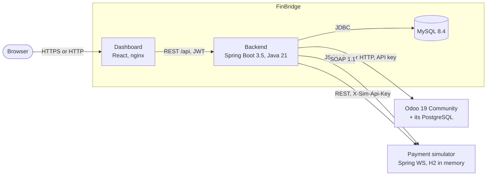
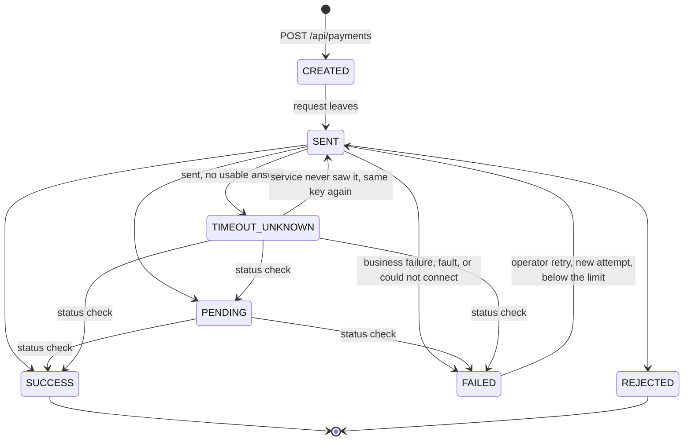

# FinBridge architecture

This describes the system **as it is built** (backend 0.7.0, simulator 0.4.0, frontend 0.7.0). The
Phase 1 design document describes what was planned and why; where the two differ, this one is
right, and the difference is listed at the end.

## What it does

FinBridge reads posted vendor bills from an Odoo ERP, lets a finance manager pay them through an
external payment service that speaks SOAP, and reconciles what it paid against that service's
settlement statement. A dashboard shows all of it, by role.

## Components



| Component | Technology | Local port | Holds |
| --- | --- | --- | --- |
| Dashboard | React 18, TypeScript, Vite, Tailwind, Recharts; nginx in the image | 5173 (dev server), 8088 (container) | Only the user's access token, in `sessionStorage` |
| Backend | Java 21, Spring Boot 3.5, Spring Security, Data JPA, Flyway, Spring WS (client) | 8080 (Maven), 8081 (container) | Every credential and every business rule |
| Database | MySQL 8.4 | 3306 | FinBridge's own data, 12 tables |
| Odoo | Odoo 19.0 Community with PostgreSQL 16 | 8069 | The ERP: vendors and vendor bills. Read-only for FinBridge |
| Payment simulator | Java 21, Spring Boot, Spring WS (server), H2 | 8090 | A stand-in for an external payment provider. Forgets everything on restart |

The backend is the only trust boundary. The browser never talks to Odoo, to the simulator or to
the database, and never sees the Odoo API key, the simulator key or a database password.

## Three integration styles

| Style | Where | Logged as |
| --- | --- | --- |
| RPC over HTTP with JSON (Odoo's External JSON-2 API) | Backend to Odoo: `POST /json/2/<model>/<method>` with a bearer API key | `ODOO` |
| SOAP 1.1, contract-first, document/literal | Backend to the payment service: submit, status inquiry, settlement statement | `SOAP` |
| REST | Browser to backend (the product's own API), and backend to the simulator's health endpoint | `REST` for the outbound call |

Every outbound call writes one row to `integration_logs` with its duration, outcome, error code
and masked payloads, under the correlation id of the request that caused it.

## Backend modules

One deployable, organised by package. A module's controller and service are its public face;
other modules do not use its repositories.

| Package | Responsibility |
| --- | --- |
| `auth`, `security`, `user` | Login, JWT, users and roles, authorization |
| `supplier`, `invoice` | Read models, search, and the rules for accepting a synchronized record |
| `integration.odoo` | The `OdooGateway` port, the JSON-2 adapter, the mock adapter, the synchronization run |
| `integration.soap` | The `PaymentGateway` port and its SOAP adapter; JAXB classes generated from the XSD |
| `integration.external` | REST client for the simulator's health endpoint |
| `integration.monitoring`, `integration.settings` | Status, health check, log viewer and retry, runtime settings |
| `payment` | The payment transaction, idempotency, the state machine, retry |
| `reconciliation` | The rule engine, runs, records, review |
| `dashboard` | Read-only figures across the other modules' tables |
| `logging` | Integration log, payload masking, correlation id |
| `config`, `common`, `exception` | Settings, the response envelope, paging, error handling |

Two ports keep external detail out of the business code. `OdooGateway` hides Odoo's model and
field names and its wire format. `PaymentGateway` hides SOAP, JAXB and fault codes, and reports
every failure as one of four kinds, so the payment module only has to ask one question: could the
request have been processed?

## The three flows

### Synchronization

```mermaid
sequenceDiagram
    actor Op as Operator
    participant BE as Backend
    participant O as Odoo
    participant DB as MySQL
    Op->>BE: POST /api/integrations/odoo/sync
    BE->>DB: open sync_runs row (RUNNING); 409 if one is running
    BE-->>Op: 202 with the run
    loop each page of suppliers, then of posted bills
        BE->>O: search_read, write_date >= cursor
        BE->>DB: one transaction: upsert, one history row per bill
    end
    BE->>DB: close run: COMPLETED, PARTIAL or FAILED; move cursor
    Op->>BE: GET sync-runs/{id} until not RUNNING
```

A bill is identified by its Odoo id, so a second run updates the same row. An invalid bill is not
stored; its reason is recorded. A bill FinBridge has started paying is never overwritten when its
amount changes in Odoo: it is marked `STALE`. Details: [odoo.md](odoo.md).

### Payment



Three rules: the transaction row exists before anything is sent; a lost answer is
`TIMEOUT_UNKNOWN`, never `FAILED`, and is resolved only by asking; `SUCCESS` and `REJECTED` are
final. Two unique keys and a row lock on the invoice make a double payment impossible, also under
concurrent requests. Details: [soap.md](soap.md).

### Reconciliation

A run fetches the settlement statement for a period over SOAP, compares it with FinBridge's
payments of that period and with a duplicate-bill check, and stores one record per finding. The
first rule that applies decides the status:

| Order | Status | When |
| --- | --- | --- |
| 1 | `DUPLICATE` | Two invoices of one supplier share a vendor reference, or the statement has two successful payments for one invoice |
| 2 | `MISSING_EXTERNAL_RECORD` | FinBridge sent a payment and the statement does not have it |
| 3 | `MISSING_INTERNAL_RECORD` | The statement has a payment FinBridge never made |
| 4 | `MISMATCH` | Both exist and invoice, supplier, currency, amount or status differ |
| 5 | `PENDING_REVIEW` | Both agree, and the payment is pending, failed or of unknown outcome |
| 6 | `MATCHED` | Both agree, and the payment succeeded or was rejected |

Reconciliation only reports. Everything that is not `MATCHED` waits for a person, who marks it
resolved or needing investigation with a note. Nothing else changes.

## Security in one page

| Concern | How |
| --- | --- |
| Authentication | Stateless JWT (HS256), 60 minutes, secret from the environment. No refresh token |
| Authorization | Three roles, enforced by URL rules and again on the methods. Roles are read from the database on every request |
| Ending a session | Disabling a user, changing their roles or resetting their password takes effect on their next request |
| Passwords | BCrypt strength 12, 12 to 72 characters; five failures lock the account for 15 minutes |
| Secrets | Environment only (`.env` locally, Parameter Store in AWS). Never in the database, the logs or an API response |
| Input | Bean Validation, allow-listed sort fields and enums, parameterized queries |
| XML | Schema validation both ways; DTDs and external entities refused on both sides |
| Browser | CSP with `script-src 'self'`, `nosniff`, frame denial, no HTML ever rendered from data |
| Audit | `initiated_by`, `triggered_by`, `reviewed_by`, `updated_by` on what people do |

The full review, with what was fixed and what was knowingly left, is [security-review.md](security-review.md).

## Roles

| Capability | ADMIN | FINANCE_MANAGER | INTEGRATION_OPERATOR |
| --- | --- | --- | --- |
| See dashboard, invoices, suppliers, payments | Yes | Yes | Yes |
| Pay an invoice | Yes | Yes | No |
| Check status of or retry a payment | Yes | No | Yes |
| Start an Odoo synchronization | Yes | No | Yes |
| Run reconciliation and review discrepancies | Yes | Yes | No |
| See integration monitoring and logs | Yes | No | Yes |
| Manage users, change settings | Yes | No | No |

Paying and retrying are held by different roles on purpose. The exact rule for every endpoint is in
[api.md](api.md), and is checked against the running backend by `scripts/api_reference.py check`.

## Where it runs

Locally everything runs from Docker Compose, or the three applications run from Maven and npm
against the Compose infrastructure. For the cloud there are CloudFormation templates for ECS
Fargate, RDS, a load balancer and one EC2 instance for Odoo. **That deployment has not been run.**
See [deployment-guide.md](deployment-guide.md).

## Differences from the Phase 1 design

| Design said | Built |
| --- | --- |
| Sync filter `write_date > cursor` | `>=`: Odoo's API returns `write_date` to the second, so the boundary record is read again and reported unchanged |
| `OdooGateway` with three methods | A fourth, fetch partners by id, for a bill whose partner the supplier pass did not return |
| Supplier field `country_id` | `country_code`, the two-letter code |
| One idempotency key per payment | A retry after a business failure is sent under a key derived from the original and the attempt number |
| V1 baseline migration only | V2 (reconciliation snapshots, run error message) and V3 (`credentials_changed_at`) |
| Spring's validating SOAP interceptor | A stricter one of our own: Spring's only logs an invalid response |
| Log retry replays "the operation behind" the entry | It starts the business operation again through its own service; the stored request is never replayed |
| CSP as part of the frontend | A response header from nginx, and a meta tag in the page |
| Simulator and backend as Compose services from Phase 4 | Added in Phase 8 under the Compose profile `app` |

## Known limits

- One backend instance. The "one synchronization at a time" rule is enforced in the application.
- Payments are for the full invoice amount; there are no partial payments or refunds, and nothing
  is written back to Odoo.
- Synchronization and reconciliation are started by hand; nothing is scheduled.
- A payment of unknown outcome stays that way until someone checks it.
- The simulator is not a bank: it keeps its state in memory and has no authentication on SOAP.
- Spring Boot 3.5 is out of open-source support since 30 June 2026.
