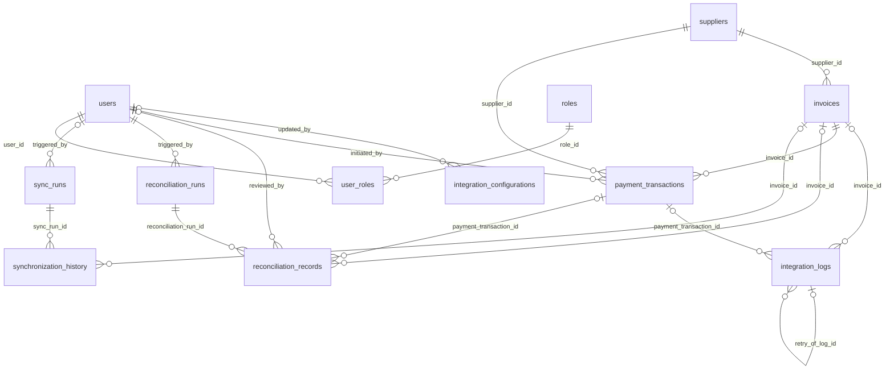

# FinBridge database

Generated by `scripts/db_reference.py` from the live schema (MySQL 8.4.13, 12 tables, 18 foreign keys). The schema is owned by Flyway; Hibernate only validates it (`ddl-auto: validate`).

## Conventions

- InnoDB, `utf8mb4`.
- Money is `DECIMAL(19,4)`, never a floating-point type.
- Timestamps are `DATETIME(3)` holding UTC.
- Status columns are `VARCHAR`, guarded twice: by a Java enum and by a `CHECK` constraint.
- `version` columns are optimistic locks: a concurrent change is refused with 409, not silently overwritten.
- Secrets are never stored: no API key, no JWT secret, no plain password.

## Migrations

| Version | Description | Type | Applied |
| --- | --- | --- | --- |
| 1 | baseline | SQL | yes |
| repeatable | dev seed data | SQL | yes |
| 2 | reconciliation details | SQL | yes |
| 3 | credentials changed at | SQL | yes |

`V1__baseline.sql` creates the twelve tables. `V2__reconciliation_details.sql` adds the run's error message and the two compared snapshots. `V3__credentials_changed_at.sql` lets a password reset end existing sessions. A repeatable migration with demo rows is loaded only under the `dev` profile (`db/dev/R__dev_seed_data.sql`); with the `prod` profile it does not exist, and the backend refuses to start on a database that already contains it.

## Entity relationships

Every line is a foreign key that exists in the database. `|o` means the referencing column may be null.

## roles

The three roles. Filled by the baseline migration; never changed at runtime.

| Column | Type | Null | Default | Notes |
| --- | --- | --- | --- | --- |
| `id` | `smallint` | no |  | primary key |
| `name` | `varchar(40)` | no |  | unique |

Indexes: `uq_roles_name` (name, unique).

Checks:
- `ck_roles_name`: `(name in (_utf8mb4\\'ADMIN\\',_utf8mb4\\'FINANCE_MANAGER\\',_utf8mb4\\'INTEGRATION_OPERATOR\\'))`

## users

People who can sign in. Passwords are BCrypt hashes.

| Column | Type | Null | Default | Notes |
| --- | --- | --- | --- | --- |
| `id` | `bigint` | no |  | primary key, auto increment |
| `email` | `varchar(190)` | no |  | unique |
| `full_name` | `varchar(120)` | no |  |  |
| `password_hash` | `varchar(100)` | no |  |  |
| `enabled` | `tinyint(1)` | no | `1` |  |
| `failed_login_count` | `int` | no | `0` |  |
| `locked_until` | `datetime(3)` | yes |  |  |
| `credentials_changed_at` | `datetime(3)` | yes |  |  |
| `last_login_at` | `datetime(3)` | yes |  |  |
| `created_at` | `datetime(3)` | no | `CURRENT_TIMESTAMP(3)` |  |
| `updated_at` | `datetime(3)` | no | `CURRENT_TIMESTAMP(3)` |  |

Indexes: `uq_users_email` (email, unique).

## user_roles

Which user has which role.

| Column | Type | Null | Default | Notes |
| --- | --- | --- | --- | --- |
| `user_id` | `bigint` | no |  | primary key, references `users.id`, delete cascades |
| `role_id` | `smallint` | no |  | primary key, references `roles.id` |

Indexes: `fk_user_roles_role` (role_id).

## suppliers

Vendors copied from Odoo (`res.partner`). `odoo_partner_id` is unique, so a partner can never become two rows.

| Column | Type | Null | Default | Notes |
| --- | --- | --- | --- | --- |
| `id` | `bigint` | no |  | primary key, auto increment |
| `odoo_partner_id` | `bigint` | no |  | unique |
| `name` | `varchar(255)` | no |  |  |
| `tax_id` | `varchar(64)` | yes |  |  |
| `email` | `varchar(190)` | yes |  |  |
| `phone` | `varchar(40)` | yes |  |  |
| `country_code` | `char(2)` | yes |  |  |
| `active` | `tinyint(1)` | no | `1` |  |
| `odoo_write_date` | `datetime(3)` | no |  |  |
| `created_at` | `datetime(3)` | no | `CURRENT_TIMESTAMP(3)` |  |
| `updated_at` | `datetime(3)` | no | `CURRENT_TIMESTAMP(3)` |  |

Indexes: `ix_suppliers_name` (name); `uq_suppliers_odoo_partner` (odoo_partner_id, unique).

## invoices

Posted vendor bills copied from Odoo (`account.move`). `odoo_move_id` is unique: the last guard against duplicate synchronization.

| Column | Type | Null | Default | Notes |
| --- | --- | --- | --- | --- |
| `id` | `bigint` | no |  | primary key, auto increment |
| `odoo_move_id` | `bigint` | no |  | unique |
| `invoice_number` | `varchar(64)` | no |  |  |
| `vendor_reference` | `varchar(128)` | yes |  |  |
| `po_reference` | `varchar(64)` | yes |  |  |
| `supplier_id` | `bigint` | no |  | references `suppliers.id` |
| `invoice_date` | `date` | no |  |  |
| `due_date` | `date` | yes |  |  |
| `untaxed_amount` | `decimal(19,4)` | no |  |  |
| `tax_amount` | `decimal(19,4)` | no |  |  |
| `total_amount` | `decimal(19,4)` | no |  |  |
| `currency` | `char(3)` | no |  |  |
| `invoice_status` | `varchar(24)` | no |  |  |
| `odoo_payment_state` | `varchar(24)` | yes |  |  |
| `sync_status` | `varchar(24)` | no |  |  |
| `odoo_write_date` | `datetime(3)` | no |  |  |
| `last_synced_at` | `datetime(3)` | no |  |  |
| `version` | `bigint` | no | `0` |  |
| `created_at` | `datetime(3)` | no | `CURRENT_TIMESTAMP(3)` |  |
| `updated_at` | `datetime(3)` | no | `CURRENT_TIMESTAMP(3)` |  |

Indexes: `ix_invoices_due_date` (due_date); `ix_invoices_number` (invoice_number); `ix_invoices_status` (invoice_status); `ix_invoices_supplier_date` (supplier_id, invoice_date); `uq_invoices_odoo_move` (odoo_move_id, unique).

Checks:
- `ck_invoices_status`: `(invoice_status in (_utf8mb4\\'OPEN\\',_utf8mb4\\'PAYMENT_IN_PROGRESS\\',_utf8mb4\\'PAID\\',_utf8mb4\\'PAYMENT_FAILED\\'))`
- `ck_invoices_sync_status`: `(sync_status in (_utf8mb4\\'SYNCED\\',_utf8mb4\\'UPDATED\\',_utf8mb4\\'STALE\\'))`
- `ck_invoices_total`: `(total_amount >= 0)`

## payment_transactions

One row per payment of an invoice, created before anything is sent. `idempotency_key` and `transaction_reference` are unique.

| Column | Type | Null | Default | Notes |
| --- | --- | --- | --- | --- |
| `id` | `bigint` | no |  | primary key, auto increment |
| `transaction_reference` | `varchar(40)` | no |  | unique |
| `idempotency_key` | `varchar(64)` | no |  | unique |
| `request_hash` | `char(64)` | no |  |  |
| `invoice_id` | `bigint` | no |  | references `invoices.id` |
| `supplier_id` | `bigint` | no |  | references `suppliers.id` |
| `requested_amount` | `decimal(19,4)` | no |  |  |
| `currency` | `char(3)` | no |  |  |
| `status` | `varchar(24)` | no |  |  |
| `external_transaction_id` | `varchar(64)` | yes |  | unique |
| `processed_amount` | `decimal(19,4)` | yes |  |  |
| `failure_reason` | `varchar(255)` | yes |  |  |
| `attempt_count` | `int` | no | `0` |  |
| `requested_at` | `datetime(3)` | no |  |  |
| `last_attempt_at` | `datetime(3)` | yes |  |  |
| `responded_at` | `datetime(3)` | yes |  |  |
| `initiated_by` | `bigint` | no |  | references `users.id` |
| `version` | `bigint` | no | `0` |  |
| `created_at` | `datetime(3)` | no | `CURRENT_TIMESTAMP(3)` |  |
| `updated_at` | `datetime(3)` | no | `CURRENT_TIMESTAMP(3)` |  |

Indexes: `fk_payment_tx_supplier` (supplier_id); `fk_payment_tx_user` (initiated_by); `ix_payment_tx_invoice` (invoice_id); `ix_payment_tx_status_requested` (status, requested_at); `uq_payment_tx_external` (external_transaction_id, unique); `uq_payment_tx_idempotency` (idempotency_key, unique); `uq_payment_tx_reference` (transaction_reference, unique).

Checks:
- `ck_payment_tx_amount`: `(requested_amount > 0)`
- `ck_payment_tx_status`: `(status in (_utf8mb4\\'CREATED\\',_utf8mb4\\'SENT\\',_utf8mb4\\'SUCCESS\\',_utf8mb4\\'PENDING\\',_utf8mb4\\'FAILED\\',_utf8mb4\\'REJECTED\\',_utf8mb4\\'TIMEOUT_UNKNOWN\\'))`

## integration_logs

One row per call to Odoo, the SOAP payment service or the simulator's REST endpoint, with masked payloads. Written once, never updated.

| Column | Type | Null | Default | Notes |
| --- | --- | --- | --- | --- |
| `id` | `bigint` | no |  | primary key, auto increment |
| `correlation_id` | `char(36)` | no |  |  |
| `integration_type` | `varchar(8)` | no |  |  |
| `operation` | `varchar(64)` | no |  |  |
| `request_reference` | `varchar(64)` | yes |  |  |
| `outcome` | `varchar(16)` | no |  |  |
| `http_status` | `smallint` | yes |  |  |
| `duration_ms` | `int` | no |  |  |
| `error_code` | `varchar(64)` | yes |  |  |
| `error_description` | `varchar(1000)` | yes |  |  |
| `invoice_id` | `bigint` | yes |  | references `invoices.id` |
| `payment_transaction_id` | `bigint` | yes |  | references `payment_transactions.id` |
| `request_payload` | `mediumtext` | yes |  |  |
| `response_payload` | `mediumtext` | yes |  |  |
| `retryable` | `tinyint(1)` | no | `0` |  |
| `retry_of_log_id` | `bigint` | yes |  | references `integration_logs.id` |
| `created_at` | `datetime(3)` | no | `CURRENT_TIMESTAMP(3)` |  |

Indexes: `fk_int_logs_invoice` (invoice_id); `fk_int_logs_payment` (payment_transaction_id); `fk_int_logs_retry_of` (retry_of_log_id); `ix_int_logs_correlation` (correlation_id); `ix_int_logs_outcome_created` (outcome, created_at); `ix_int_logs_reference` (request_reference); `ix_int_logs_type_created` (integration_type, created_at).

Checks:
- `ck_int_logs_outcome`: `(outcome in (_utf8mb4\\'SUCCESS\\',_utf8mb4\\'FAILURE\\',_utf8mb4\\'TIMEOUT\\'))`
- `ck_int_logs_type`: `(integration_type in (_utf8mb4\\'ODOO\\',_utf8mb4\\'REST\\',_utf8mb4\\'SOAP\\'))`

## sync_runs

One row per Odoo synchronization run: its cursor window, counters and outcome.

| Column | Type | Null | Default | Notes |
| --- | --- | --- | --- | --- |
| `id` | `bigint` | no |  | primary key, auto increment |
| `trigger_type` | `varchar(16)` | no |  |  |
| `triggered_by` | `bigint` | yes |  | references `users.id` |
| `status` | `varchar(16)` | no |  |  |
| `cursor_from` | `datetime(3)` | yes |  |  |
| `cursor_to` | `datetime(3)` | yes |  |  |
| `suppliers_upserted` | `int` | no | `0` |  |
| `invoices_created` | `int` | no | `0` |  |
| `invoices_updated` | `int` | no | `0` |  |
| `invoices_unchanged` | `int` | no | `0` |  |
| `invoices_rejected` | `int` | no | `0` |  |
| `error_message` | `varchar(1000)` | yes |  |  |
| `started_at` | `datetime(3)` | no |  |  |
| `finished_at` | `datetime(3)` | yes |  |  |

Indexes: `fk_sync_runs_user` (triggered_by); `ix_sync_runs_status_started` (status, started_at).

Checks:
- `ck_sync_runs_status`: `(status in (_utf8mb4\\'RUNNING\\',_utf8mb4\\'COMPLETED\\',_utf8mb4\\'PARTIAL\\',_utf8mb4\\'FAILED\\'))`
- `ck_sync_runs_trigger`: `(trigger_type in (_utf8mb4\\'MANUAL\\',_utf8mb4\\'SCHEDULED\\'))`

## synchronization_history

What one synchronization run did with one Odoo record.

| Column | Type | Null | Default | Notes |
| --- | --- | --- | --- | --- |
| `id` | `bigint` | no |  | primary key, auto increment |
| `sync_run_id` | `bigint` | no |  | references `sync_runs.id` |
| `entity_type` | `varchar(16)` | no |  |  |
| `odoo_record_id` | `bigint` | no |  |  |
| `invoice_id` | `bigint` | yes |  | references `invoices.id` |
| `action` | `varchar(24)` | no |  |  |
| `message` | `varchar(500)` | yes |  |  |
| `created_at` | `datetime(3)` | no | `CURRENT_TIMESTAMP(3)` |  |

Indexes: `ix_sync_hist_invoice_created` (invoice_id, created_at); `ix_sync_hist_run` (sync_run_id).

Checks:
- `ck_sync_hist_action`: `(action in (_utf8mb4\\'CREATED\\',_utf8mb4\\'UPDATED\\',_utf8mb4\\'UNCHANGED\\',_utf8mb4\\'REJECTED_INVALID\\',_utf8mb4\\'FAILED\\'))`
- `ck_sync_hist_entity`: `(entity_type in (_utf8mb4\\'SUPPLIER\\',_utf8mb4\\'INVOICE\\'))`

## reconciliation_runs

One row per reconciliation run: its period, counters and outcome.

| Column | Type | Null | Default | Notes |
| --- | --- | --- | --- | --- |
| `id` | `bigint` | no |  | primary key, auto increment |
| `triggered_by` | `bigint` | no |  | references `users.id` |
| `period_from` | `date` | no |  |  |
| `period_to` | `date` | no |  |  |
| `status` | `varchar(16)` | no |  |  |
| `total_records` | `int` | no | `0` |  |
| `matched_count` | `int` | no | `0` |  |
| `discrepancy_count` | `int` | no | `0` |  |
| `error_message` | `varchar(1000)` | yes |  |  |
| `started_at` | `datetime(3)` | no |  |  |
| `finished_at` | `datetime(3)` | yes |  |  |

Indexes: `fk_recon_runs_user` (triggered_by).

Checks:
- `ck_recon_runs_period`: `(period_from <= period_to)`
- `ck_recon_runs_status`: `(status in (_utf8mb4\\'RUNNING\\',_utf8mb4\\'COMPLETED\\',_utf8mb4\\'FAILED\\'))`

## reconciliation_records

One finding of one run, with both sides as they were compared and the review decision.

| Column | Type | Null | Default | Notes |
| --- | --- | --- | --- | --- |
| `id` | `bigint` | no |  | primary key, auto increment |
| `reconciliation_run_id` | `bigint` | no |  | references `reconciliation_runs.id` |
| `invoice_id` | `bigint` | yes |  | references `invoices.id` |
| `payment_transaction_id` | `bigint` | yes |  | references `payment_transactions.id` |
| `internal_transaction_reference` | `varchar(40)` | yes |  |  |
| `external_transaction_reference` | `varchar(64)` | yes |  |  |
| `expected_amount` | `decimal(19,4)` | yes |  |  |
| `actual_amount` | `decimal(19,4)` | yes |  |  |
| `currency` | `char(3)` | yes |  |  |
| `status` | `varchar(32)` | no |  |  |
| `discrepancy_description` | `varchar(1000)` | yes |  |  |
| `internal_snapshot` | `text` | yes |  |  |
| `external_snapshot` | `text` | yes |  |  |
| `review_status` | `varchar(24)` | no |  |  |
| `review_note` | `varchar(1000)` | yes |  |  |
| `reviewed_by` | `bigint` | yes |  | references `users.id` |
| `reviewed_at` | `datetime(3)` | yes |  |  |
| `reconciled_at` | `datetime(3)` | no |  |  |

Indexes: `fk_recon_rec_payment` (payment_transaction_id); `fk_recon_rec_reviewer` (reviewed_by); `ix_recon_rec_invoice` (invoice_id); `ix_recon_rec_run_status` (reconciliation_run_id, status).

Checks:
- `ck_recon_rec_review`: `(review_status in (_utf8mb4\\'NOT_REQUIRED\\',_utf8mb4\\'OPEN\\',_utf8mb4\\'RESOLVED\\',_utf8mb4\\'NEEDS_INVESTIGATION\\'))`
- `ck_recon_rec_status`: `(status in (_utf8mb4\\'MATCHED\\',_utf8mb4\\'MISMATCH\\',_utf8mb4\\'MISSING_EXTERNAL_RECORD\\',_utf8mb4\\'MISSING_INTERNAL_RECORD\\',_utf8mb4\\'DUPLICATE\\',_utf8mb4\\'PENDING_REVIEW\\'))`

## integration_configurations

Runtime settings an administrator changed. Non-secret values only.

| Column | Type | Null | Default | Notes |
| --- | --- | --- | --- | --- |
| `id` | `bigint` | no |  | primary key, auto increment |
| `config_key` | `varchar(100)` | no |  | unique |
| `config_value` | `varchar(500)` | no |  |  |
| `description` | `varchar(255)` | yes |  |  |
| `updated_by` | `bigint` | yes |  | references `users.id` |
| `updated_at` | `datetime(3)` | no | `CURRENT_TIMESTAMP(3)` |  |

Indexes: `fk_int_config_user` (updated_by); `uq_int_config_key` (config_key, unique).
